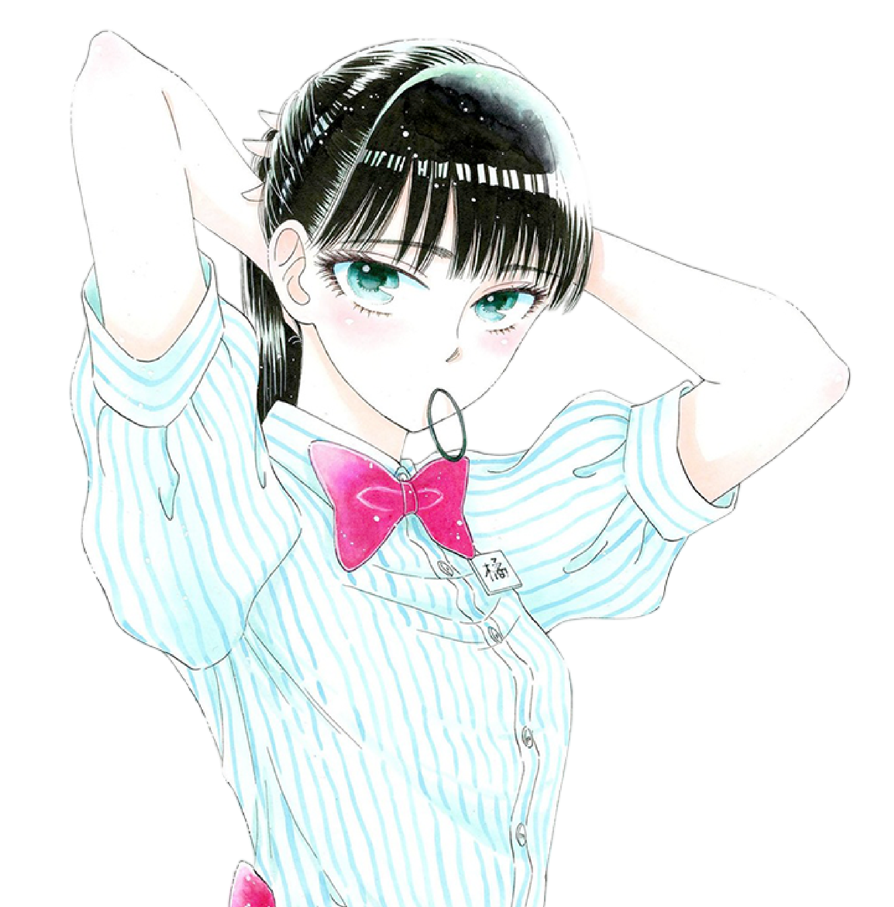

  
   
  

  <h3><strong>その日私たちが見た花</strong></h3>
  

    <strong>D E S I G N</strong>
    &nbsp; • &nbsp;
    <strong>T E C N O L O G I A</strong>
    &nbsp; • &nbsp;
    <strong>I N T E L I G Ê N C I A &nbsp; A R T I F I C I A L</strong>
  

 

  

    

  

    <h3>Oi ✦</h3>
    

      Gosto de criar coisas misturando criatividade e tecnologia. Meu primeiro contato
      com programação foi em 2013, usando o Small Basic. Em algum momento da minha
      infância, passei a amar tecnologia — principalmente inteligência artificial —
      e boa parte disso foi graças à Cortana, de Halo.
    

    

      Desde então, continuo explorando ideias que passam por programação, interfaces,
      design, bots, jogos, automação e inteligência artificial. Gosto especialmente
      de transformar ideias curiosas em coisas que realmente funcionam.
    

    

      
      
      
    

  

 

 

<h1 align="left"><strong>O &nbsp; Q U E &nbsp; E U &nbsp; F A Ç O</strong></h1>

  

  

    Crio coisas entre <strong>design, programação e tecnologia</strong>, tentando sempre
    transformar ideias em experiências que sejam bonitas, úteis e interessantes de usar.
    Isso vai desde interfaces e aplicações web até bots, automações e ferramentas próprias.
  

  

    Uma parte grande do que faço hoje também passa por <strong>inteligência artificial</strong>:
    gosto de experimentar com agentes, integrações entre modelos e ferramentas, automação
    de tarefas e infraestrutura para tornar esses sistemas mais rápidos e capazes.
  

  

    Também mexo com <strong>redes, servidores e infraestrutura</strong>, e gosto bastante de ensinar.
    Dou aula e tento explicar assuntos técnicos de um jeito mais visual, direto e fácil de testar na prática.
  

  

    
    &nbsp;
    
    &nbsp;
    
    &nbsp;
    
    &nbsp;
    
    &nbsp;
    
    &nbsp;
    
  

 

 

<h1 align="left"><strong>S T A T U S</strong></h1>

  

  

 

   

  

    

  

