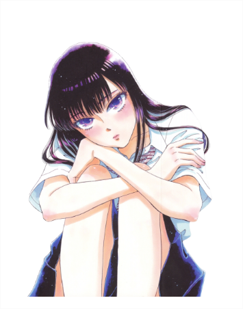
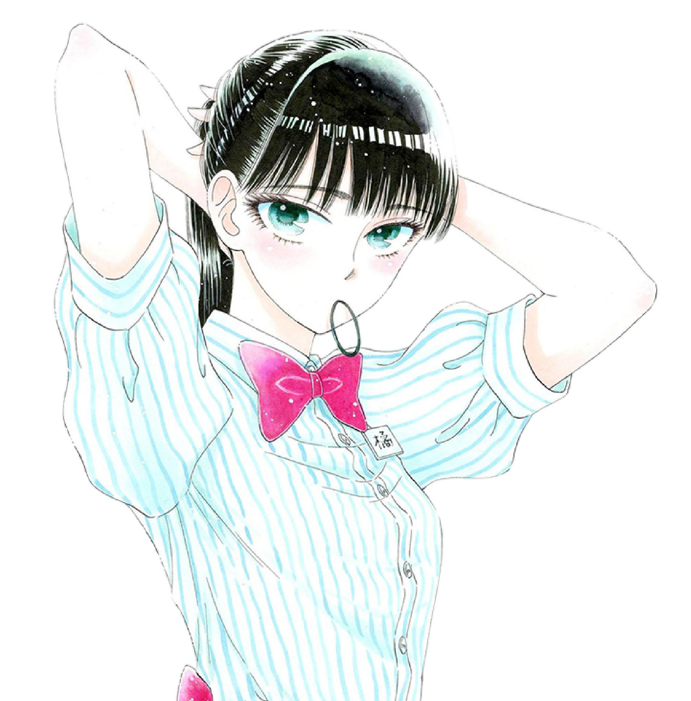

  
    
  
  <h3>Oi ✦</h3>
  

    Gosto de criar coisas misturando criatividade e tecnologia. Meu primeiro contato 
    com programação foi em 2013, usando o Small Basic. Em algum momento da minha 
    infância, passei a amar tecnologia.
  

   
  

  <h3><strong>その日私たちが見た花</strong></h3>

<table align="center">
  <tr>
    <td align="center" valign="middle" width="82">
      
    </td>
    <td align="center" valign="middle" width="350">
      <h3>Design &amp; Criatividade</h3>
      Interfaces · Identidade visual · Edição
    </td>
    <td align="center" valign="middle" width="260" rowspan="3">
      
    </td>
  </tr>
  <tr>
    <td align="center" valign="middle">
      
    </td>
    <td align="center" valign="middle">
      <h3>Desenvolvimento</h3>
      Web · Aplicações · Ferramentas próprias
    </td>
  </tr>
  <tr>
    <td align="center" valign="middle">
      
    </td>
    <td align="center" valign="middle">
      <h3>IA &amp; Automação</h3>
      Agentes · Bots · Integrações
    </td>
  </tr>
</table>

  
  

 

<h1 align="left"><strong>O &nbsp; Q U E &nbsp; E U &nbsp; F A Ç O</strong></h1>

<table align="center">
  <tr>
    <td align="center" valign="middle" width="280">
      
    </td>
    <td align="center" valign="middle" width="410">
      <h3>Criar · Desenvolver · Experimentar</h3>
      

        
        &nbsp;&nbsp;
        
        &nbsp;&nbsp;
        
        &nbsp;&nbsp;
        
      

      

        
        &nbsp;&nbsp;
        
        &nbsp;&nbsp;
        
      

    </td>
  </tr>
</table>

 

<h1 align="left"><strong>C O N E X Õ E S</strong></h1>

<table align="center">
  <tr>
    <td align="center" valign="middle" width="350">
      
    </td>
    <td align="center" valign="middle" width="340">
      <!-- LinkedIn: adicionar a URL do perfil quando estiver disponível. -->
       
      <!-- Protteu: adicionar a URL pública quando estiver disponível. -->
       
      
    </td>
  </tr>
</table>

    
  
    
  

