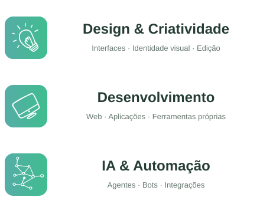

  
   
  
  <h2>Oi ✦</h2>
  

    Gosto de criar coisas misturando criatividade e tecnologia. Meu primeiro contato 
    com programação foi em 2013, usando o Small Basic. Em algum momento da minha 
    infância, passei a amar tecnologia.
  

  

  <h3><strong>その日私たちが見た花</strong></h3>

  <picture>
    <source media="(prefers-color-scheme: dark)" srcset="assets/areas-criativas-dark.svg" />
    
  </picture>

  
  

<h1 align="left"><strong>O &nbsp; Q U E &nbsp; E U &nbsp; F A Ç O</strong></h1>

  
     

        
        &nbsp;&nbsp;
        
        &nbsp;&nbsp;
        
        &nbsp;&nbsp;
        
      

      

        
        &nbsp;&nbsp;
        
        &nbsp;&nbsp;
        
      

 

<h1 align="left"><strong>C O N E X Õ E S</strong></h1>

  
  

    <!-- LinkedIn: adicionar a URL do perfil quando estiver disponível. -->
     
    <!-- Protteu: adicionar a URL pública quando estiver disponível. -->
     
    
  

 

   
  
   
  

